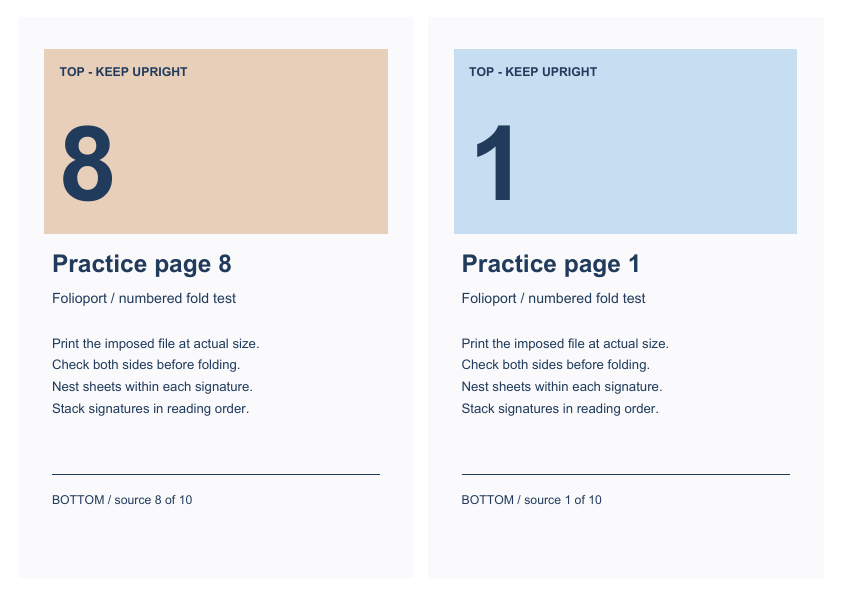

# Folioport

From pages to folded paper.

**[Open Folioport](https://folioport-beryl.vercel.app)**

Folioport turns a small PDF into a real two-up booklet PDF, entirely in your browser. Choose a sheet size, signature size and binding edge; inspect the page order and added blank panels before taking the file to your printer.

- **Actual PDF output:** source page artwork is embedded into landscape A4 or US Letter sheets.
- **Signature grouping:** one booklet or smaller folding groups; the final signature pads only to the next multiple of four.
- **Left or right binding:** panel placement changes on both fronts and backs.
- **Crop-aware fitting:** visible crop rectangles are proportionally fitted and centered within your margins and center gap.
- **Independent order audit:** reconstruct the folded reading sequence and check every source page appears exactly once.
- **Portable receipts:** complete CSV, JSON, HTML and SVG order maps, plus reusable settings.
- **Local processing:** no uploads, analytics, accounts, remote APIs or browser storage.

## Real output preview



Actual exported PDF, rendered with Poppler: source page 8 on the left and page 1 on the right. All six sample output sides were rendered and visually inspected. This is **not an application screenshot**. Native browser layout, screen-reader interaction, operating-system downloads and physical duplex printing remain unverified; a real workspace screenshot is pending.

Download [the original numbered practice PDF](examples/numbered-practice.pdf) and [the imposed booklet PDF](examples/booklet.pdf) to inspect or make a physical folding test.

## Run locally

Requires Node.js 22 or 24, npm, and a modern browser with WebCrypto and `String.isWellFormed`. Use HTTPS or localhost.

```sh
npm ci --ignore-scripts --no-audit --no-fund
npm test
npm run build
npm run dev
```

Open [http://127.0.0.1:4223](http://127.0.0.1:4223). The build bundles the pinned PDF engine into `dist/app.js`; no CDN or network access is needed for processing after assets load.

Runtime dependency: `pdf-lib@1.17.1` and its locked transitive dependencies. Build / test tools: pinned esbuild and JSDOM. Full bundled runtime license texts are in [THIRD_PARTY_NOTICES.txt](THIRD_PARTY_NOTICES.txt) and shipped with the website.

## Make a booklet

1. Open a small, unencrypted PDF, or choose **Try numbered sample**.
2. Choose landscape A4 or US Letter, a signature size, and left or right binding.
3. Set outer margins and the gap between the two page panels, in millimeters.
4. Choose **Make booklet PDF**. Review the page count, signature groups, blank panels and front/back ordering.
5. Download **Booklet PDF** and inspect it in a PDF viewer before printing.

The workspace shows an **order diagram**, not a render of your source artwork. The generated PDF contains the actual source artwork. Every page is fitted proportionally; pages can shrink or enlarge, so check text size.

The source PDF is never overwritten. Settings files contain only settings and notes, **not the source PDF**. Reopen the PDF separately when returning to a saved setup. Receipts include the source filename, geometry and SHA-256 fingerprint, but no source bytes.

Draft edits mark the previous output stale and disable downloads. Failed imports keep previous work. Later edits or source changes discard pending results; they do not interrupt PDF parsing already in progress. Clearing or closing releases the current in-memory workflow; no automatic persistent copy is created. This is not a secure-memory-erasure guarantee.

## Print and fold

The output PDF is already two-up. Each physical sheet has two consecutive output PDF pages: **front, then back**.

- Choose landscape and actual size / 100%.
- Enable two-sided printing, usually **short-edge flip**.
- Do **not** enable a printer's own booklet or multiple-pages-per-sheet option.
- Print the numbered sample first, check orientation and front/back pairing, then fold and confirm the reading order.
- Within each signature, nest the listed sheets from outermost to innermost. Stack completed signatures in their listed order.

Printer drivers vary. Manual-duplex stack/reinsertion order is not generated. There is no automatic back rotation, creep compensation, bleed, cover design, trim marks or professional print preflight. Physical paper size, printable area, color, duplex behavior and binding results have not been tested.

## Ordering rule

For an eight-page left-bound signature, output sides are:

| Physical sheet | Face | Left source page | Right source page |
| --- | --- | --- | --- |
| 1 | Front | 8 | 1 |
| 1 | Back | 2 | 7 |
| 2 | Front | 6 | 3 |
| 2 | Back | 4 | 5 |

Right binding mirrors each pair. Each signature starts from its own source-page range.

For 18 source pages with a 16-page signature limit, the first signature contains pages 1–16. The last contains 17–18 and two blank panels, occupying one additional sheet. It does not expand to another full 16-page signature.

The auditor independently places the viewed panels back into the folded reading sequence, checks exact source-page coverage and validates sheet/face numbering and blank counts. This does not prove correct physical folding or printer configuration.

## Artwork and document features

Folioport makes a **new page-artwork PDF**. It does not retain source links, annotations, bookmarks, tags, attachments, interactive document structure or original document metadata. Generated PDF metadata uses fixed Unix-epoch timestamps; those are reproducibility markers, not publication or creation dates. The preflight displays how many source annotations were found; visible annotation appearances may therefore be absent in output.

Interactive fields, XFA and page widgets, including orphan widgets and signature widgets, are rejected rather than silently flattened. Do not use this tool to preserve signatures, accessibility tagging, forms or archival conformance.

Only zero-rotation source pages with standard page units and supported crop rectangles are accepted. Normalize unsupported rotations in another tool first. Crop rectangles are respected, so artwork outside the source crop rectangle is not printed.

Folioport does not decrypt, bypass restrictions, sanitize, redact, repair or establish PDF/A compliance. Use only PDFs you own or are authorized to process. Complex files can be slow or fail even within the size limit.

## Limits

| Boundary | Limit |
| --- | --- |
| Source size | Nonempty, up to 10 MiB |
| Source pages | 1–128 |
| Signature size | 0 for one booklet, or a multiple of four from 4–128 |
| Output | At most 64 PDF pages / 32 physical sheets |
| Sheet sizes | Landscape A4 or US Letter |
| Margins / center gap | 0–20 mm each |
| Crop dimensions | Each dimension 36–3,000 PDF points; finite, within MediaBox |
| Source rotation / UserUnit | Zero rotation; UserUnit absent or 1 |
| Forms / XFA / widgets | Rejected |
| Title / notes | 100 / 4,000 UTF-16 units |
| Settings import | 40,000 bytes; strict versioned schema |
| Visible order table | 12 sides per page; exports include all sides |

No OCR, image-to-PDF conversion, four-up layouts, slicing/cutting signatures, arbitrary page selection or source-page editing. No guarantee of fast processing for every supported input.

## Exports

| Download | Contains |
| --- | --- |
| Booklet PDF | Complete imposed page artwork |
| Save settings | Title, sheet/signature settings, margins, binding and notes |
| Full JSON receipt | Settings, source fingerprint/geometry, all sides, placements and audit |
| Page-order CSV | Complete sheet/face/left/right mapping |
| HTML print guide | Complete order table, diagram and setup guidance |
| Order map SVG | Complete numbered diagram, not source artwork |

The standalone numbered-sample download provides a source PDF for testing. Export pagination never removes pages. Notes, filenames and fingerprints in reports may be sensitive; review before sharing.

## Verification and examples

`npm test` runs **29 automated checks**, including:

- Golden eight-page left/right order and **2,304** count/signature/binding combinations.
- Fold reconstruction, exact page coverage, blank panels and tampered-plan rejection.
- Proportional fit and crop offsets.
- Actual output PDF page counts and decoded embedded source artwork in expected left/right draw order.
- Intentional blank source pages, form/widget rejection, rotation/unit/size limits and annotation handling.
- Simulated DOM builds using real PDF generation, stale outputs, custom signature settings, import/build races, complete exports, markup escaping and actual binary Blob payloads.

CI runs tests and builds on Windows and Linux with Node 22 and 24. Poppler `pdfinfo`, `pdftotext` and `pdftoppm` were also used to independently inspect and render all six output sides of the included ten-page numbered sample. This does not establish native browser or physical-print behavior. The encrypted-file rejection relies on pdf-lib's non-bypass loader setting; no encrypted fixture is claimed tested.

`npm run example` regenerates seven artifacts in [examples](examples/). The original pages and artwork are synthetic and included; no third-party book content is bundled.

## Deploy to Vercel

Import this repository. Choose **Other**, Node **24.x**, install command `npm ci --ignore-scripts --no-audit --no-fund`, build command `npm run build`, output directory `dist`, and the repository root as the project root.

No environment variables, database, paid integrations, purchased domains or paid APIs are required. `vercel.json` supplies build settings, content-type protection, no-referrer and CSP headers blocking application network connections.

MIT licensed. Third-party bundled components retain their own notices.
